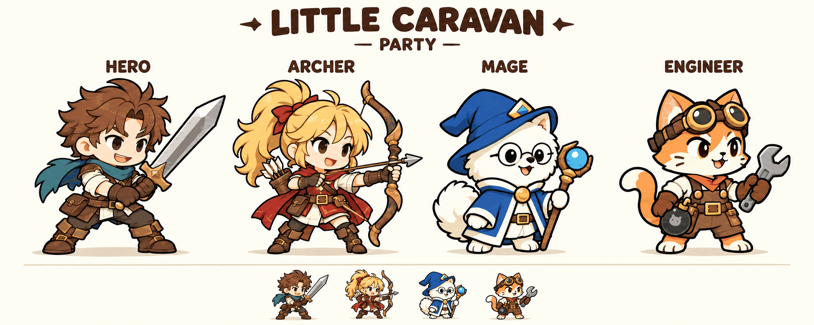

# Little Caravan — 확정 캐릭터 외형 참고

## 확정 조합

- 주인공: A안. 갈색 머리, 청록색 스카프, 갈색 가죽옷, 양손검.
- 궁수: A안. 금발 포니테일, 빨간 리본, 레드 계열 의상, 활과 화살통.
- 마법사: 흰색 복슬복슬한 강아지 B안. 동그란 안경, 파란 모자와 파란 의상. 모자에 가려진 귀는 그리지 않고 반대쪽 귀만 보이게 한다.
- 기술자: 고양이 A안. 주황·크림색 털, 머리 위 고글, 작업복, 렌치, 폭탄.

## Codex 적용 지침

이 이미지는 선택된 4인 일행의 외형·색상·그림체 기준이다. 큰 캐릭터와 아래쪽 축소 예시를 포함한다.

완성된 애니메이션 아틀라스나 리깅 부품이 아니므로, 이미지를 동작 프레임으로 간주하거나 단순히 전체 그림을 흔들어서 모든 공격 동작이 완성됐다고 처리하지 않는다.

인게임은 굵은 외곽선과 단순한 색면의 간결한 2D 스타일을 유지한다. 무기는 별도 리소스로 관리할 수 있도록 설계하되, 두 손의 그립과 몸·팔·무기의 앞뒤 겹침을 검수한다. 대기·공격·복귀의 기준 자세를 일관되게 유지한다.

당장의 목표는 정식 게임 화면보다 캐릭터 동작 테스트 필드이다. 자세별 아트가 준비되지 않은 동작은 임시 구현임을 명시한다.

원본: 사용자가 2026-10-29 확정한 최신 금발 궁수 버전의 AI 생성 일러스트.
